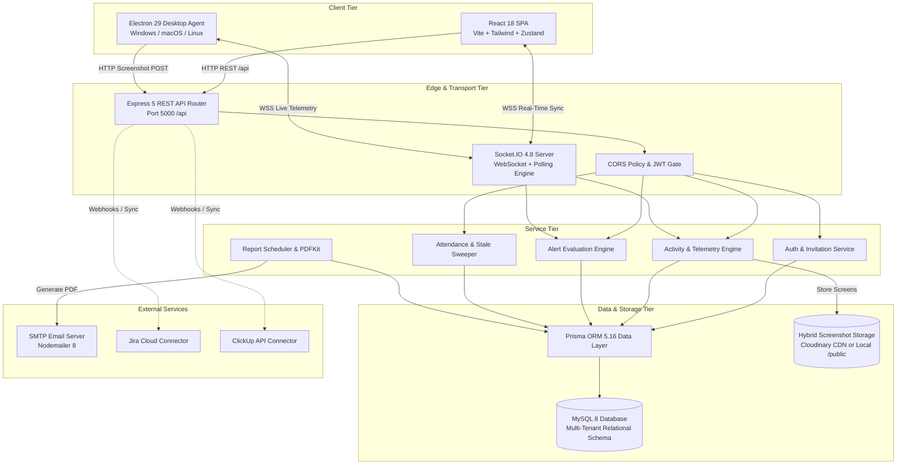
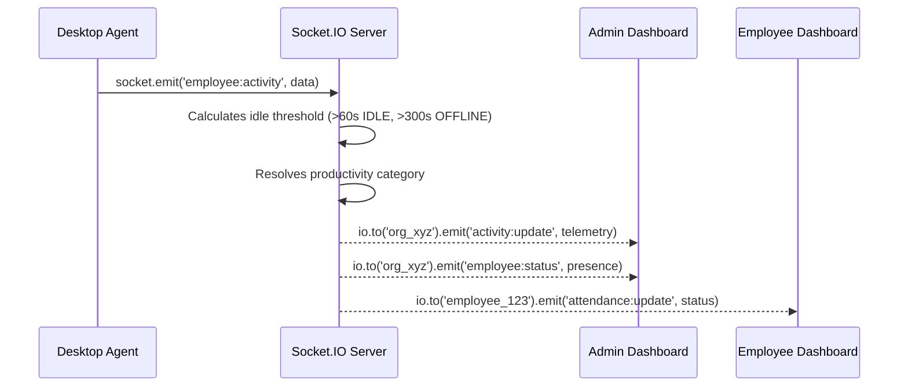

# Technical Architecture Specification — Employee Monitoring System

**Document Version:** 1.0.0  
**Effective Date:** November 19, 2026  
**Audience:** System Architects, Staff Engineers, Infrastructure Engineers  

---

## 1. System Architecture Overview

The Employee Monitoring System is a multi-tier distributed application engineered for high-throughput client telemetry collection, sub-second socket streaming, multi-tenant relational persistence, and interactive administrative reporting.

---

## 2. Technology Stack & Component Specifications

| Architecture Layer | Technology | Version | Purpose |
| :--- | :--- | :--- | :--- |
| **Frontend Framework** | React.js | `^18.2.0` | Component-driven user interface. |
| **Frontend Build Tool** | Vite | `^5.0.10` | Fast HMR development and Rollup production bundling. |
| **Frontend State** | Zustand | `^5.0.11` | Lightweight, unopinionated reactive store. |
| **Frontend Styling** | Tailwind CSS | `^3.4.0` | Utility-first responsive design supporting light and dark themes. |
| **Backend Runtime** | Node.js | `>=18.0.0` | Server-side JavaScript execution environment. |
| **API Framework** | Express.js | `^5.2.1` | Next-generation routing, middleware pipeline, and controllers. |
| **Database & ORM** | MySQL + Prisma ORM | `@prisma/client ^5.16.2` | Type-safe query builder, relational migrations, and data models. |
| **Real-Time Engine** | Socket.IO | `^4.8.3` | Low-latency bi-directional event transport between agent and UI. |
| **Image Processing** | Sharp | `^0.34.5` | High-performance image resizing, format conversion, and Gaussian blurring. |
| **Document Generation**| PDFKit | `^0.20.2` | Vector-based PDF report compiler for automated email schedules. |
| **Scheduler Engine** | node-cron | `^4.2.1` | In-process cron job scheduler for report sweeps and maintenance. |
| **Desktop App** | Electron | `^29.3.1` | Chromium + Node desktop runtime for background system monitoring. |

---

## 3. Tier-Specific Architecture Details

### 3.1 Frontend Web Application Architecture
The client application is organized as a single-page application under `employee-monitoring-frontend/src/`:
- **Layouts (`src/layouts/`):** `DashboardLayout.jsx` provides the common responsive shell, collapsible sidebar navigation, luxury warm palette, and active top header.
- **Routing & Role Isolation (`src/components/ProtectedRoute.jsx`):**
  - `ProtectedRoute`: Verifies that a valid JWT token exists in `localStorage` and syncs user session via `/api/auth/me`.
  - `RoleRoute`: Validates that the active user's role matches route boundaries (`/admin/*`, `/manager/*`, `/employee/*`).
- **Real-Time Context (`src/hooks/RealTimeContext.jsx`):** Subscribes to the central Socket.IO connection and distributes live updates (employee statuses, activity ticks, new alerts) across consuming components via React Context.

### 3.2 Backend API & Middleware Pipeline
Incoming HTTP requests pass through a sequential pipeline in `employee-monitoirng-backend/src/app.js`:
1. `cors()`: Validates origin against `FRONTEND_URL`.
2. `express.json({ limit: '10mb' })`: Parses incoming JSON with safety thresholds.
3. `/api` Router (`src/routes/index.js`): Maps URL endpoints to module routers.
4. `authMiddleware` (`src/middlewares/auth.middleware.js`):
   - Decodes JWT bearer token.
   - Confirms user is not in `DEACTIVATED` state.
   - Enriches `req.user` with current `employeeId`, `organizationId`, and verified DB `role`.
5. `roleMiddleware` (`src/middlewares/role.middleware.js`): Rejects unauthorized roles with HTTP 403.
6. `errorMiddleware` (`src/middlewares/error.middleware.js`): Global uncaught error handler returning consistent error schemas.

---

## 4. Multi-Tenant Architecture & Data Isolation

Data isolation is guaranteed through **Logical Multi-Tenancy**:
1. **Tenant Anchor:** Every tenant is represented by a record in `organizations`.
2. **Scoping Pattern:** All Prisma queries filter on `organizationId`. A centralized helper `getOrganizationId(req)` safely resolves the tenant identifier from the verified JWT token.
3. **Socket Channel Partitioning:** Sockets join room `org_${organizationId}` immediately after handshake, ensuring presence events, timeline updates, and employee activities never leak across tenant boundaries.

---

## 5. Real-Time Socket.IO & Telemetry Architecture

### Socket Room Architecture:
- `org_${organizationId}`: Broadcasts global presence, active app ticks, and screenshot notifications.
- `org_${organizationId}_managers`: Restricted to Admin and Manager roles; receives sensitive security violation notifications.
- `employee_${employeeId}`: Unicast channel for point-to-point commands (e.g., live stream session requests or personal notifications).

---

## 6. Background Jobs & Scheduled Task Architecture

1. **Automated PDF Email Report Dispatcher (`reportScheduler.js`):**
   - Scheduled via `node-cron` to execute daily at 08:00 AM (`0 8 * * *`).
   - Sweeps active `EmailReport` records, pulls aggregated metrics via `reports.service.js`, compiles PDF buffers via `pdfReportBuilder.js`, and dispatches emails via `nodemailer`.
   - Prevents duplicate dispatches using an in-memory `dispatchedHistory` set.
2. **Stale Session Sweeper (`processAllStaleSessions` in `server.js`):**
   - Runs every 60 seconds (`setInterval`).
   - Automatically clocks out attendance sessions for agents that have sent zero telemetry for 10+ minutes.
3. **Screenshot Cleanup Service (`cleanup.service.js`):**
   - Implements a **Permanent Retention Policy** (automated deletion is disabled; screenshots remain until manually pruned by administrators).

---

## 7. Storage, Security & Environment Configuration

### 7.1 Screenshot Storage Strategy
- **Cloudinary Mode:** When `CLOUDINARY_CLOUD_NAME`, `CLOUDINARY_API_KEY`, and `CLOUDINARY_API_SECRET` are configured, processed JPEG buffers are uploaded directly to Cloudinary's secure media storage.
- **Local Fallback Mode:** When Cloudinary is not configured, screenshots are saved to `public/uploads/screenshots/` and served statically via Express.

### 7.2 Cryptography & Credentials
- Passwords: Salted and hashed using `bcrypt` (10 rounds).
- Tokens: Signed JWTs using `jsonwebtoken` with HMAC SHA-256 and 24-hour expiration.
- Invites: 32-byte cryptographically secure random hexadecimal tokens (`crypto.randomBytes(32)`).
