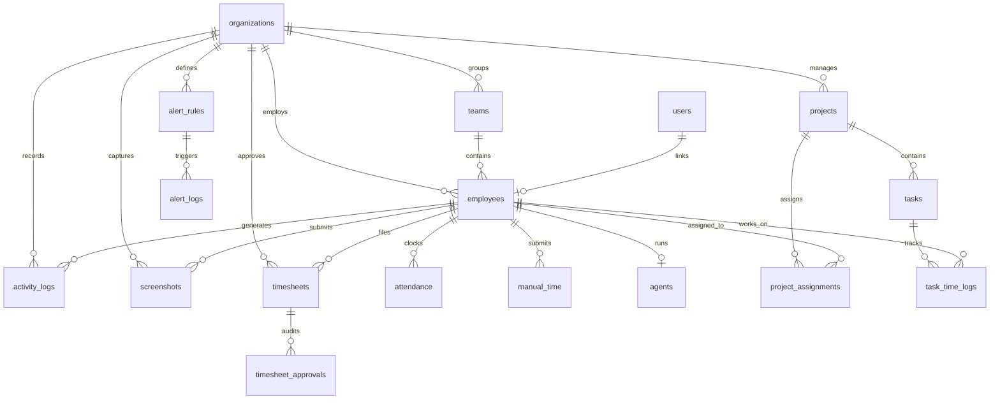

# Database Architecture & Schema Specification

**Document Version:** 1.0.0  
**Effective Date:** November 19, 2026  
**Database Engine:** MySQL 8.0+  
**ORM / Data Access Layer:** Prisma ORM 5.16.2 (`@prisma/client`)  
**Schema File:** `employee-monitoirng-backend/prisma/schema.prisma`  

---

## 1. Database Overview & Design Principles

The database employs a multi-tenant relational schema optimized for high-write telemetry ingestion (activity logs, keystroke counts, window switching, screenshot metadata) and high-read reporting analytics.

### Key Architectural Characteristics:
1. **Multi-Tenant Partitioning:** Every core business entity carries an `organizationId` foreign key referencing `organizations(id)` to enforce organizational isolation.
2. **Primary Key Standard:** All primary keys utilize 36-character globally unique identifiers (`UUIDv4`) generated via `@default(uuid())`.
3. **Table Naming Conventions:** Database tables use lower `snake_case` through Prisma `@@map("...")` directives (e.g., `organizations`, `employees`, `activity_logs`), while model and field declarations in JavaScript/TypeScript use `camelCase`.
4. **Soft Deletions & Status Flags:** Employee accounts and organization groups preserve operational integrity via status flags (`ACTIVE`, `DEACTIVATED`, `OFFLINE`).

---

## 2. High-Level Entity-Relationship (ER) Diagram



---

## 3. Enumerations (Enum Types)

| Enum Name | Values | Purpose |
| :--- | :--- | :--- |
| **`Role`** | `ADMIN`, `MANAGER`, `EMPLOYEE` | Access control tier across backend endpoints and frontend views. |
| **`ActivityType`** | `ACTIVE`, `IDLE`, `MANUAL`, `SYSTEM`, `BREAK` | Classification of telemetry records. |
| **`ProductivityType`** | `PRODUCTIVE`, `NEUTRAL`, `UNPRODUCTIVE` | Categorization of application usage based on organization rules. |
| **`TaskStatus`** | `BACKLOG`, `IN_OPERATIONS`, `QUALITY_ASSURANCE`, `FINALIZED` | Kanban pipeline state for assigned project tasks. |
| **`TaskPriority`** | `LOW`, `MEDIUM`, `HIGH`, `CRITICAL` | Task urgency ranking. |
| **`EmployeeStatus`** | `INVITED`, `ACTIVE`, `OFFLINE`, `IDLE`, `BREAK`, `DEACTIVATED`, `MERGED` | Real-time presence and account lifecycle state. |
| **`ComputerType`** | `COMPANY`, `PERSONAL` | Computer ownership governing permitted tracking profiles. |
| **`TimesheetStatus`** | `DRAFT`, `SUBMITTED`, `APPROVED`, `REJECTED` | Multi-stage lifecycle of employee timesheet reviews. |
| **`PayrollStatus`** | `PAID`, `UNPAID` | Settlement state of payroll line items. |
| **`InvoiceStatus`** | `DRAFT`, `SENT`, `PENDING`, `PAID`, `OVERDUE`, `CANCELLED` | Multi-tenant billing status. |

---

## 4. Comprehensive Model Directory & Schema Dictionary

The system schema defines **47 models**. The core business models are documented below:

### 4.1 Identity, Tenancy & Organization Hierarchy

#### `Organization` (`organizations`)
Central multi-tenant anchor.
- `id` (String, PK, UUID): Unique organization identifier.
- `legalName` (String): Corporate business name.
- `workspaceId` (String, Unique, UUID): Unique identifier for subdomains and invite links.
- `timeZone` (String, Default: "UTC"): Organization operational timezone.
- `workStartTime` / `workEndTime` (String, Default: "09:00" / "18:00"): Standard operating shift.
- `workDays` (String): Comma-separated active days ("Monday,Tuesday,...").
- *Relations:* Links to all tenant resources (`employees`, `teams`, `projects`, `activityLogs`, etc.).

#### `User` (`users`)
Authentication account table.
- `id` (String, PK, UUID): User account ID.
- `email` (String, Unique): Login email address.
- `password` (String): Hashed password using bcrypt.
- `role` (Role, Default: `EMPLOYEE`): User role (`ADMIN`, `MANAGER`, `EMPLOYEE`).
- `employeeId` (String, Unique, Nullable): Foreign key linking to an `Employee` record.
- *Relations:* One-to-one mapping with `Employee`.

#### `Employee` (`employees`)
Workforce member profile containing operational parameters.
- `id` (String, PK, UUID): Employee ID.
- `fullName` (String): Full name.
- `email` (String, Unique): Work email address.
- `role` (Role, Default: `EMPLOYEE`): Operational role.
- `status` (EmployeeStatus, Default: `ACTIVE`): Account state.
- `hourlyRate` (Float, Default: 0): Base billing/payroll rate.
- `computerType` (ComputerType, Default: `COMPANY`): Tracking policy boundary.
- `teamId` (String, Nullable, FK): References `teams(id)`.
- `organizationId` (String, FK): References `organizations(id)`.
- `workMode` (String, Default: "Remote"): On-premise, Hybrid, or Remote.

#### `Team` (`teams`)
Organizational units for grouping employees and scoping manager permissions.
- `id` (String, PK, UUID): Team ID.
- `name` (String): Department or unit name (e.g., "Engineering", "QA").
- `organizationId` (String, FK): References `organizations(id)`.

---

### 4.2 Telemetry, Activity & Screenshots

#### `ActivityLog` (`activity_logs`)
High-frequency log recording active application usage.
- `id` (String, PK, UUID): Record ID.
- `employeeId` (String, FK): References `employees(id)`.
- `organizationId` (String, FK): References `organizations(id)`.
- `appName` (String): Executable or process name (e.g., "chrome.exe", "Code.exe").
- `windowTitle` (String, Nullable, Text): Active window title string.
- `duration` (Int): Time spent in seconds during the interval.
- `productivity` (ProductivityType, Default: `NEUTRAL`): `PRODUCTIVE`, `NEUTRAL`, `UNPRODUCTIVE`.
- `timestamp` (DateTime, Default: `now()`): Start of telemetry window.

#### `AppUsageLog` (`app_usage_logs`)
Consolidated daily application usage counters.
- `id` (String, PK, UUID): Log ID.
- `employeeId` (String, FK): References `employees(id)`.
- `organizationId` (String, FK): References `organizations(id)`.
- `appName` (String): Application name.
- `domain` (String, Nullable): Browser URL domain if applicable.
- `totalDuration` (Int): Aggregated duration in seconds.
- `date` (DateTime): Calendar date bucket.

#### `Screenshot` (`screenshots`)
Visual audit captures taken by the Desktop Agent.
- `id` (String, PK, UUID): Screenshot ID.
- `employeeId` (String, FK): References `employees(id)`.
- `organizationId` (String, FK): References `organizations(id)`.
- `imageUrl` (String, Text): Relative storage path or Cloudinary HTTPS CDN URL.
- `blurredUrl` (String, Nullable, Text): Pre-blurred alternative image URL.
- `capturedAt` (DateTime, Default: `now()`): Time of capture.

---

### 4.3 Time Tracking & Attendance

#### `Attendance` (`attendance`)
Continuous work sessions from clock-in to clock-out.
- `id` (String, PK, UUID): Session ID.
- `employeeId` (String, FK): References `employees(id)`.
- `organizationId` (String, FK): References `organizations(id)`.
- `clockIn` (DateTime): Timestamp of clock-in.
- `clockOut` (DateTime, Nullable): Timestamp of clock-out (null while shift is active).
- `duration` (Int, Default: 0): Total shift duration in seconds.
- `breakDuration` (Int, Default: 0): Total accumulated break time in seconds.
- `date` (DateTime): Calendar session date.

#### `ManualTime` (`manual_time_entries`)
Employee-requested offline work intervals.
- `id` (String, PK, UUID): Entry ID.
- `employeeId` (String, FK): References `employees(id)`.
- `organizationId` (String, FK): References `organizations(id)`.
- `startTime` / `endTime` (DateTime): Requested interval.
- `duration` (Int): Interval in seconds.
- `reason` (String, Text): Explanation submitted by employee.
- `status` (String, Default: "PENDING"): "PENDING", "APPROVED", "REJECTED".

---

### 4.4 Projects, Tasks & Connectors

#### `Project` (`projects`)
- `id` (String, PK, UUID): Project ID.
- `name` (String): Project name.
- `billableRate` (Float): Hourly billing rate.
- `budget` (Float): Budget threshold.
- `organizationId` (String, FK): References `organizations(id)`.

#### `Task` (`tasks`)
- `id` (String, PK, UUID): Task ID.
- `name` (String): Task title.
- `status` (TaskStatus, Default: `BACKLOG`): Kanban column.
- `priority` (TaskPriority, Default: `MEDIUM`): Priority tier.
- `projectId` (String, FK): References `projects(id)`.
- `employeeId` (String, Nullable, FK): Assignee.

---

### 4.5 Security, Alerts & Schedulers

#### `AlertRule` (`alert_rules`)
Rules evaluated against incoming telemetry.
- `id` (String, PK, UUID): Rule ID.
- `name` (String): Rule name.
- `type` (String): "UNPRODUCTIVE_APP", "EXCESSIVE_IDLE", "OFF_HOURS_ACTIVITY".
- `conditions` (Json): JSON structure with thresholds and target app names.
- `isActive` (Boolean, Default: true): Evaluation state.

#### `EmailReport` (`email_reports`)
Automated report configurations dispatched by `reportScheduler.js`.
- `id` (String, PK, UUID): Configuration ID.
- `name` (String): Report name.
- `frequency` (String, Default: "weekly"): "daily", "weekly", "monthly".
- `recipients` (String, Text): Comma-delimited email addresses.
- `isActive` (Boolean, Default: true): Dispatch trigger.

---

## 5. Migrations & Backup Strategy

### Migration Execution
Prisma migrations are generated and applied via:
```bash
npx prisma migrate dev --name <migration_name>
```
In automated environments, generation is verified with:
```bash
npx prisma generate
```

### Production Backup & Recovery Standard:
- **Daily Snapshot:** Automated `mysqldump` snapshot taken daily at 02:00 AM UTC.
- **Point-in-Time Recovery:** MySQL binary logging (`binlog`) enabled with a 7-day retention window.
