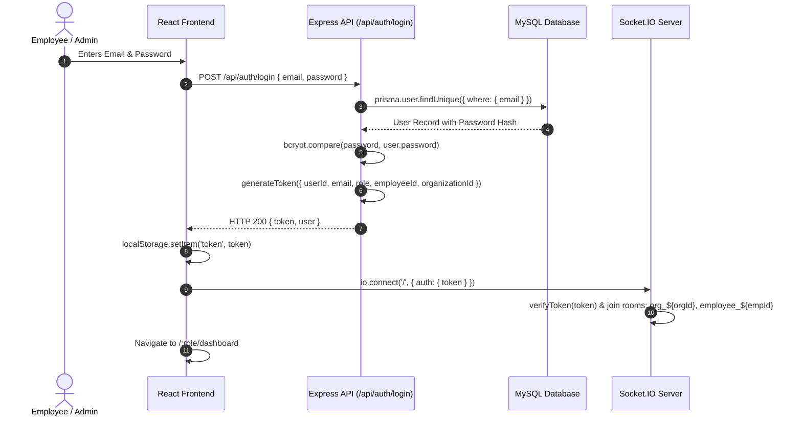
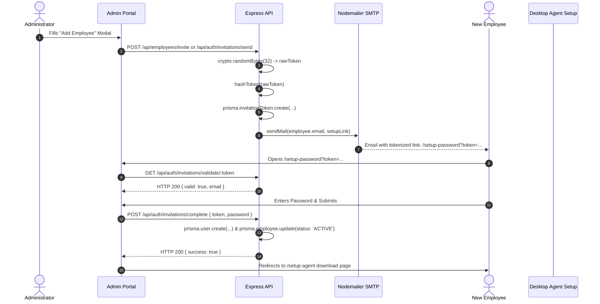
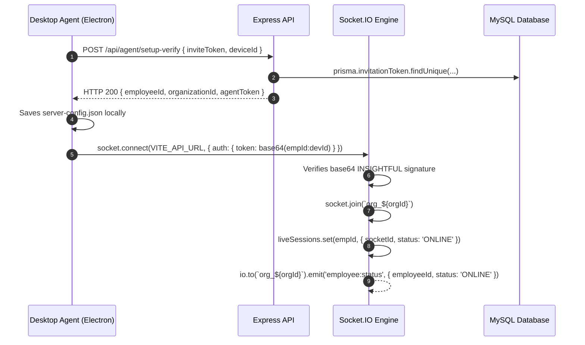
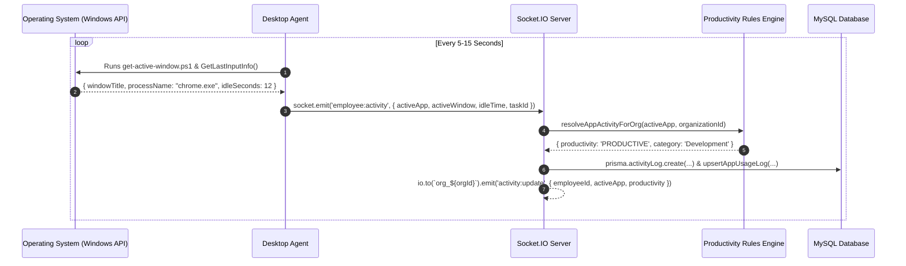
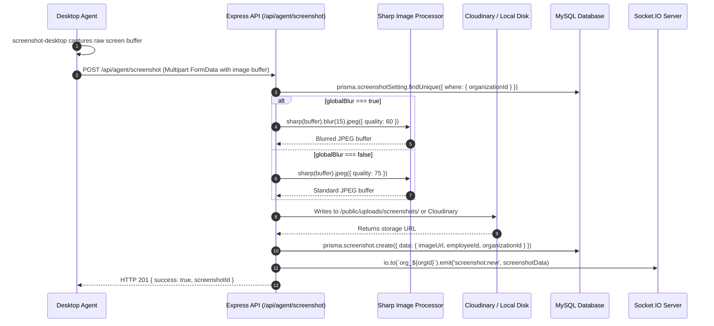
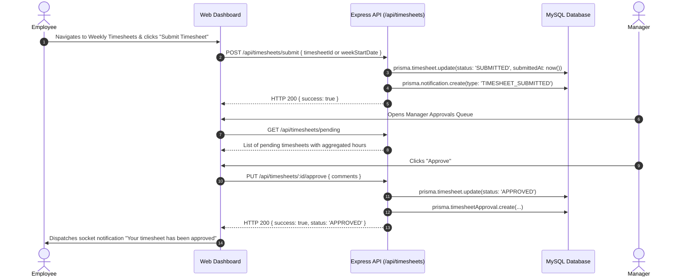
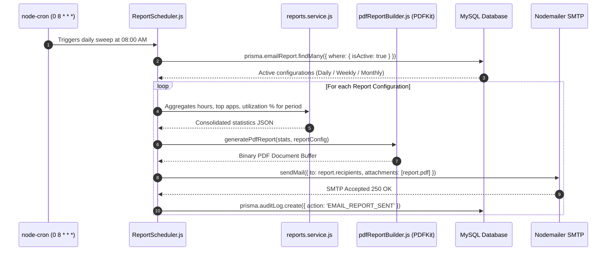
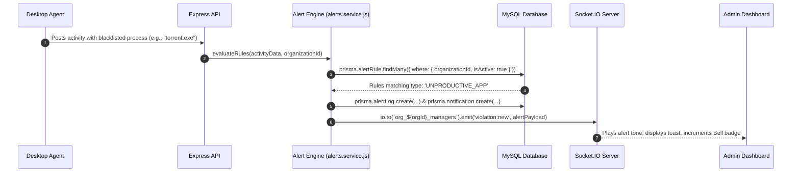

# System Workflows & Sequence Guide — Employee Monitoring System

**Document Version:** 1.0.0  
**Effective Date:** November 19, 2026  
**Audience:** Architects, Full-Stack Engineers, DevOps  

---

## 1. System Authentication & Onboarding Workflows

### 1.1 User Login & Session Establishment

- **Initiator:** End-user (Admin, Manager, or Employee).
- **Frontend Action:** Submits credentials form on `/login`.
- **API Endpoint:** `POST /api/auth/login`.
- **Backend Processing:** Validates credentials via `bcrypt.compare`, verifies account is not deactivated, crafts JWT signed with `JWT_SECRET`.
- **Database Operations:** Queries `users` and `employees` tables.
- **Response:** HTTP 200 `{ success: true, token, user }`.
- **Subsequent Action:** Frontend stores JWT, initializes Socket.IO connection, and redirects to role-based dashboard.

---

### 1.2 Employee Invitation & Tokenized Password Setup

---

## 2. Desktop Agent Telemetry & Time Tracking Workflows

### 2.1 Desktop Agent Connection & Socket Authentication

---

### 2.2 Live Activity Ingestion & Smart Idle Detection

- **Initiator:** Background thread of Electron Desktop Agent.
- **Frontend Action:** Dashboard listens to `activity:update` and ticks intraday bars live.
- **API / Socket Event:** `socket.emit('employee:activity', payload)`.
- **Backend Processing:** Checks idle thresholds (`>60s` transitions to `IDLE`, `>300s` transitions to `OFFLINE`). Categorizes productivity based on organizational rules.
- **Database Operations:** Inserts into `activity_logs` and increments seconds in `app_usage_logs`.
- **Subsequent Action:** Updates in-memory `liveSessions` map and emits `activity:update` to the organization room.

---

### 2.3 Screenshot Capture & Privacy Blurring

---

## 3. Timesheet Approval Workflow

---

## 4. Background Automated PDF Email Report Workflow

---

## 5. Security Alert & Violation Notification Flow

